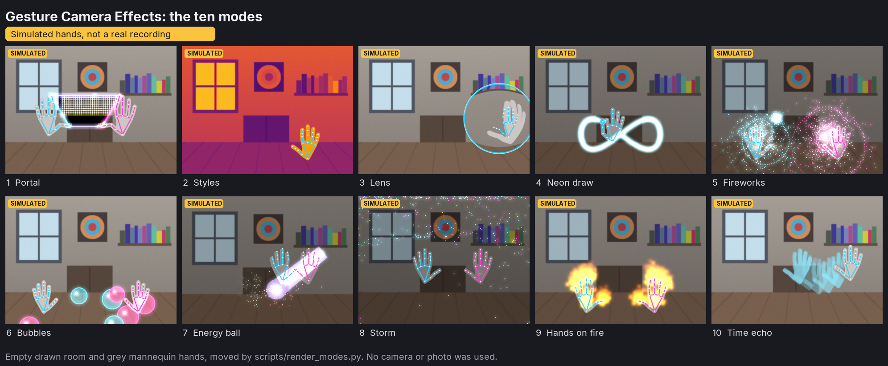

# Gesture Camera Effects

Live webcam effects controlled by your hands. Pinch, spread, flick and point at the
camera, and the picture warps, burns, draws and explodes in real time. It runs on a
plain CPU, handles several people at once, and has a photo booth and a kiosk mode for
running it on a big screen at an event.

## Demo

Footage from the event will be added here later.

Until then, the sheet below shows all ten modes. It was rendered by
`python scripts/render_modes.py` with simulated hands over a drawn background, so it
is not a real recording and shows no people.



## Why it exists

I built this to show that I can take a real-time computer vision idea from a plan to
something a crowd can walk up to and use. It covers the full loop: camera capture,
hand tracking, gesture recognition that holds up for different people, effects that
fit a frame budget on a CPU, and a UI that is readable from two metres away. It is
also the starting point for a Raspberry Pi 5 version, so it has no GPU code and every
part reports what it costs.

## What it does

Ten modes, switched with keys 1 to 9 and 0 (key 0 is mode 10) or by holding a
fingertip on the on-screen NEXT and PREVIOUS buttons.

| Mode | Name | How to play |
|------|------|-------------|
| 1 | Portal | Thumbs and index fingers of both hands make a frame; inside it the video is restyled. Pinch both hands and let go to change the look. |
| 2 | Styles | Twelve whole-frame looks: cartoon, sketch, comic, oil paint, neon glow, edges, thermal, night vision, vintage, duotone, glitch, pixelate. Right-hand pinch: next look; left-hand pinch: previous. |
| 3 | Lens | Your pinch is a magnifying glass; open your fingers to make it bigger. |
| 4 | Neon draw | Touch thumb and index to draw glowing lines in the air; they fade after a few seconds. Make a fist to clear. |
| 5 | Fireworks | Pinch and let go to launch; squeeze hard for sparks. |
| 6 | Bubbles | Bubbles in the colours of the hands in view. Pop your own colour to score; another player's colour resets your score. |
| 7 | Energy ball | Hold your hands close to charge, then thrust: the ball fires the way you push, or at the camera. |
| 8 | Storm | Swipe through the falling sparks; open hands push harder. |
| 9 | Hands on fire | Spread your fingers for bigger flames; flick a hand to throw a fireball. |
| 10 | Time echo | Whatever moves leaves fading ghosts in its player's colour; pinch and let go to freeze one. |

- **Group play.** Up to four hands are tracked at once (`--max-hands`). Each hand
  keeps its own colour across frames, even if it leaves the picture and comes back,
  and effects such as bubbles and the portal work with several people.
- **Photo booth.** Two peace signs held for 1.5 s (or the `p` key) start a
  countdown, a flash, and save a photo to `photos/`, which is never committed.
- **Kiosk.** `--kiosk` runs fullscreen with a hidden cursor and a larger UI.
  When nobody is in front of the camera for 6 s (`--attract-after`), a "wave a
  hand" screen appears.
- **On-screen help.** A small info button (or the `i` key) shows how to play the
  current mode.

## Install

Tested with Python 3.12 on Windows 11.

```
python -m venv .venv
.venv\Scripts\activate            # Linux / macOS: source .venv/bin/activate
pip install -r requirements.txt
python scripts/download_model.py  # MediaPipe hand model into models/ (about 8 MB)
```

For the tests, install `requirements-dev.txt` instead.

## Usage

```
python -m gesture_fx                         # window, 640x480 camera
python -m gesture_fx --kiosk                 # fullscreen event mode
python -m gesture_fx --mode 4                # start in neon draw
python -m gesture_fx --max-hands 2           # track fewer hands, faster
python -m gesture_fx --brand "Some Club" --logo logo.png   # name and logo in a corner
python -m gesture_fx --record-gif photos/demo.gif --gif-seconds 8   # git-ignored
python -m gesture_fx --benchmark 30          # run 30 s, print display FPS and tracking rate
python -m gesture_fx --pi                    # Raspberry Pi profile (automatic on a Pi)
python -m gesture_fx --help                  # every flag
```

| Flag | What it does |
|------|--------------|
| `--kiosk` | Fullscreen, hidden cursor, larger UI |
| `--max-hands N` | Most hands tracked at once (default 4, 2 on a Pi; fewer is faster) |
| `--mode 1-10` | Mode to start in (mode 10 is on key 0) |
| `--brand NAME` | Show a name in a glass badge in the top-left corner; nothing is shown by default |
| `--logo IMAGE` | Show a logo in the badge next to the `--brand` name |
| `--record-gif PATH` | 3 s countdown, record `--gif-seconds` of the screen, save the GIF and exit |
| `--benchmark SECONDS` | Run for that long, then print the camera FPS, display/effects FPS, tracking results per second and tracking time, per hand count |
| `--pi`, `--no-pi` | Turn the Raspberry Pi profile on, or off on a Pi (it is detected by itself) |
| `--track-wait MS` | Longest wait for the current frame's hands before carrying the last ones forward (default 20, 0 on a Pi) |
| `--camera`, `--width`, `--height` | Camera index and requested resolution |
| `--switch-hold SECONDS` | How long a fingertip must stay on NEXT or PREVIOUS (default 1.5) |
| `--no-mirror`, `--swap-hands` | Turn off the mirror image; swap left and right hands |

| Key | Action |
|-----|--------|
| 1 to 9, 0 | Choose a mode (0 is mode 10) |
| p | Photo |
| c | Clear neon drawing |
| i | Show or hide the info card |
| v | Show or hide FPS and tracking time |
| f | Fullscreen on or off |
| l | Hand skeleton on or off |
| s | Save a screenshot to `debug/` (git-ignored) |
| d | Save a landmark check image to `debug/` |
| q or Esc | Quit |

## Raspberry Pi 5

The same code runs on a Raspberry Pi 5 (64-bit Raspberry Pi OS, CPU only). The Pi is
detected by itself and switches on a lighter profile (`--pi` forces it on another
machine, `--no-pi` turns it off):

- Up to 2 hands instead of 4 (`--max-hands` still overrides it).
- The picture never waits for hand tracking. Tracking takes about 60 ms on the Pi, so
  it runs on its own thread on the newest frame while the effects keep the camera's
  30 FPS; between tracking results each hand is carried forward along its recent
  motion for at most 4 frames.
- Lighter effects: the four costliest styles (cartoon, comic, oil paint, neon glow)
  run at half size, time echo keeps 3 ghosts instead of 5, and particle caps are about
  halved (fireworks, bubbles, energy ball, storm, hands on fire, neon draw points).

Install v4l-utils as well:

```
sudo apt install v4l-utils
```

Many webcams lower their frame rate in dim light to expose longer (a Logitech C920s
drops to about 15 FPS). On Linux the app asks the camera for MJPG at 30 FPS and turns
that off at startup with `v4l2-ctl --set-ctrl=exposure_dynamic_framerate=0`; without
v4l-utils, or on a camera without that control, it skips this step. The frame rate the
camera really delivers is printed at startup and in the benchmark.

To measure on the Pi, with your hands in view for part of the run:

```
python -m gesture_fx --benchmark 30 --no-display
python -m gesture_fx --benchmark 30 --kiosk
python scripts/bench_render.py --lite --hands 1 2
```

The first gives the camera, effects and tracking numbers without a window; the second
includes drawing to the screen; the third times each mode's effects alone.

## How it works

```
camera -> tracking -> players -> mode -> UI -> window
```

| Module | Job |
|--------|-----|
| `camera.py` | Capture on a background thread that always hands back the newest frame; MJPG at 30 FPS |
| `tracking.py` | MediaPipe hand landmarks on their own thread; the only module that imports MediaPipe |
| `gestures.py` | Pure NumPy gesture math, no OpenCV or MediaPipe, fully unit tested |
| `players.py` | Turns raw hands into per-hand state (stable id, colour, openness, speed) and carries hands forward between tracking results |
| `modes.py`, `playful.py`, `effects.py`, `fxkit.py` | The ten modes and the effects they draw |
| `buttons.py` | NEXT, PREVIOUS and info buttons pressed by a fingertip |
| `photobooth.py`, `recorder.py` | Photo countdown and saving; GIF recording |
| `ui.py`, `display.py` | On-screen UI and the scaled window |
| `app.py`, `config.py` | Main loop and command-line flags |

Because the main loop only sees plain frames and hand objects, moving to a different
camera or tracker touches one file.

**Gesture math.** Every hand is 21 landmarks. The pinch is the thumb-to-index
distance divided by the palm size (wrist to middle knuckle), so it reads the same
whether the hand is near the camera or far away. That ratio is mapped to an
openness value from 0 to 1. A pinch "click" uses two thresholds, one to close and a
wider one to release, so a shaky hand does not fire it twice. A fist is all four
fingertips closer to the wrist than their middle joints, with thumb and index apart
so it is not mistaken for a pinch. Buttons fire after a fingertip dwells for
1.5 s and ignore one-frame tracking dropouts. Hands keep their identity between
frames by matching against where each hand is predicted to be.

**Why MediaPipe Tasks.** The older `mediapipe.solutions` API is no longer the
supported path; the Tasks `HandLandmarker` is current, runs on the CPU, and has
a VIDEO mode that tracks between frames instead of detecting from scratch every
frame. Frames are padded to a square before tracking, which matches what the model
expects and keeps landmarks on the fingers.

**Performance.** One measured number, from `--benchmark 30` at 640x480 on my laptop:

| Average FPS | Tracking time per frame |
|-------------|-------------------------|
| TBD | TBD |

## Tests

```
pip install -r requirements-dev.txt
python -m pytest
```

The tests cover the gesture math: pinch ratio and openness, pinch clicks, fist and
peace detection, hand identity, the two-hand pinch and the button dwell timer.
`python scripts/bench_render.py` times every mode with simulated hands, without a
camera.

## What I wanted to learn

- How to build a real-time vision loop that stays within a frame budget on a CPU.
- How to turn noisy landmarks into gestures that work for many different hands,
  using scale-free measures, hysteresis and timing rather than single thresholds.
- How to keep several people apart in one picture so each keeps their colour and
  score.
- How to design an interface for a big screen and strangers who have never seen it.
- How to structure a project so the same code can move to a Raspberry Pi.

## How it was built

I wrote a plan first: the modules, the gesture math, and how each step would be
checked. I then built it with Claude Code, one step at a time, from that plan. I
tested every change live in front of the camera, reported what felt wrong, and
tuned the gestures and effects from what I saw. The unit tests and scripted runs
check the logic; the live sessions decided what stayed.

## License

MIT. See [LICENSE](LICENSE). The bundled Inter font is under the SIL Open Font
License; see `gesture_fx/assets/fonts/OFL.txt`.
